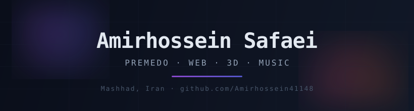
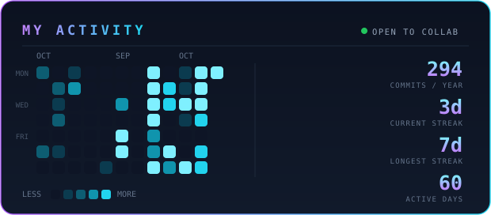

  

 

**17 y/o developer from Mashhad, Iran** 🇮🇷  
Building things that live in the browser — from music players to 3D cities.

---

### 🔧 Stack

  
  
  
  
  
  
  
  
  

---

### 📌 Featured

<table>
<tr>
<td width="50%">

**🎵 [Harmonia](https://github.com/Amirhossein41148/Harmonia)**  
A self-contained PHP music player — zero frameworks, clean UI, full-featured.  
`PHP` `PWA` `Media Session`

</td>
<td width="50%">

**🌆 [3D Portfolio](https://amirhossein41148.github.io/amirhossein-portfolio/)**  
Walk through a cyberpunk city — built with plain Three.js, no React.  
`JavaScript` `Three.js` `WebGL`

</td>
</tr>
</table>

---

### 📈 Stats

  
  

  

---

### 📊 Activity

  

---

  
  &nbsp;
  
  &nbsp;
  

